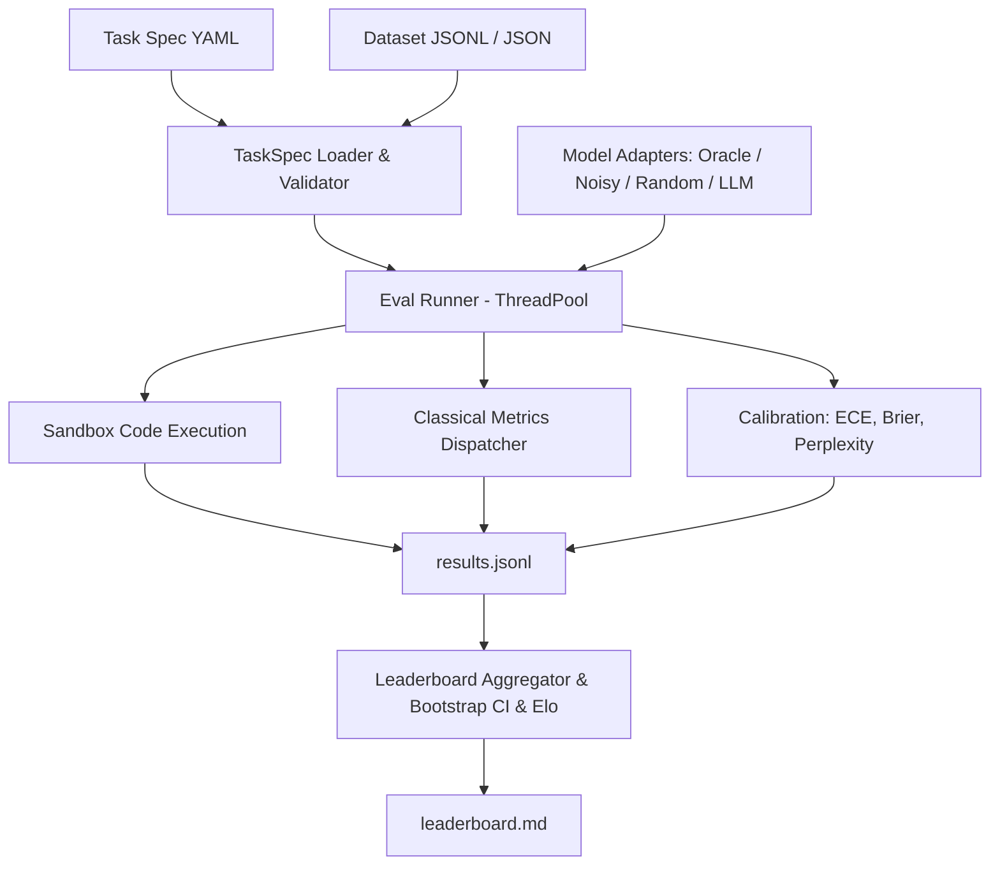

# evalkit

Evaluation runner and benchmark harness built from first principles (lessons 70–75).

## Problem

Evaluating LLMs accurately requires consistent metric definitions, reproducible sandboxed execution, statistical confidence estimation, and standardized task specifications. Without rigorous harnesses, benchmark results diverge across libraries due to hidden tokenization assumptions, uncalibrated confidence scores, and flawed aggregation.

`evalkit` provides an end-to-end evaluation runner with:
1. Pydantic v2 YAML task specifications with variable validation
2. Pure Python implementations of classical metrics (exact match, token F1, BLEU-4, ROUGE-L, chrF, accuracy)
3. Subprocess code execution sandbox with CPU/memory limits and unbiased Codex pass@k
4. Perplexity and Expected Calibration Error (ECE) with reliability diagrams
5. Bootstrap confidence intervals and deterministic Bradley-Terry / Elo ratings
6. Resumable multi-threaded evaluation runner with automated markdown leaderboard generation

## Architecture



## Quickstart

```bash
# Run evaluations across bundled tasks
uv run evalkit run --tasks packages/evalkit/tasks --models oracle,noisy:0.3,random --out runs/demo

# View leaderboard
uv run evalkit leaderboard runs/demo
```

## Results

Benchmark results on bundled evaluation tasks (35 arithmetic, 35 trivia MCQ, 10 HumanEval-style, 35 sentiment; 345 example×model pairs):

| Rank | Model | Macro Mean | 95% CI | Win Rate | Elo Rating | ECE (15 bins) | Brier Score |
|------|-------|------------|--------|----------|------------|---------------|-------------|
| 1 | oracle | 1.000 | [1.000, 1.000] | 0.822 | 1181.9 | 0.010 | 0.000 |
| 2 | noisy:0.3 | 0.654 | [0.548, 0.730] | 0.554 | 1273.6 | 0.099 | 0.238 |
| 3 | random | 0.057 | [0.026, 0.122] | 0.124 | 544.5 | 0.256 | 0.138 |

Per-task means:

| Model | arithmetic_qa | code_humaneval | sentiment | trivia_mcq |
|-------|---------------|----------------|-----------|------------|
| oracle | 1.000 | 1.000 | 1.000 | 1.000 |
| noisy:0.3 | 0.657 | 0.700 | 0.600 | 0.657 |
| random | 0.000 | 0.000 | 0.000 | 0.229 |

Rerun of the same command reported `Evaluated: 0, Skipped: 345` (full resume).

Headline: **oracle macro mean = 1.000 > noisy:0.3 = 0.654 > random = 0.057**.

## Design Decisions

- **Zero-Dependency Core Metrics**: Metrics are implemented directly with NumPy and standard library to ensure mathematical transparency and prevent external library drift.
- **Subprocess Isolation**: Code execution runs with `python -I` under temporary working directories with POSIX CPU limits (5s) and address space limits (512MB) applied via `preexec_fn`.
- **Unbiased pass@k**: Implemented using Chen et al. (2021) unbiased combinatoric formulation to prevent finite-sample estimation bias.
- **Strict Spec Invariants**: Template variables declared in prompt templates are strictly validated against dataset rows upon loading to eliminate runtime format errors.
