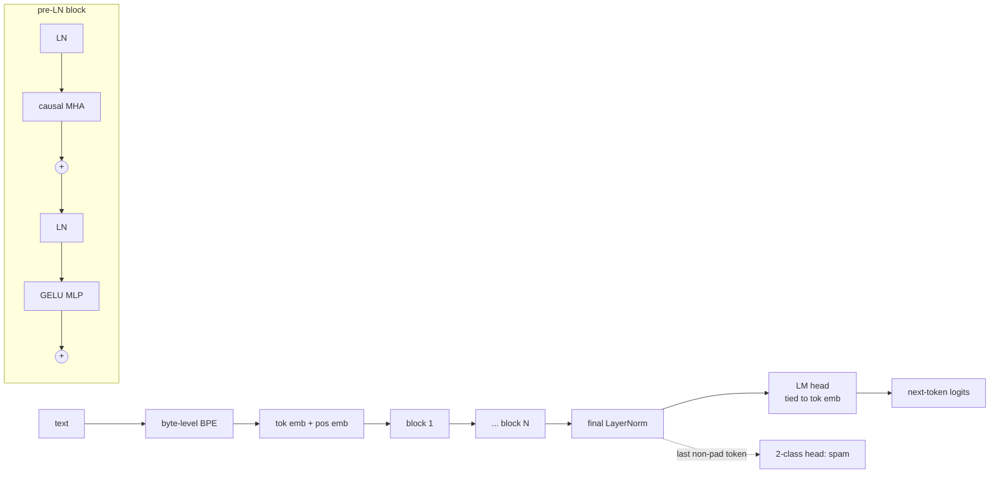
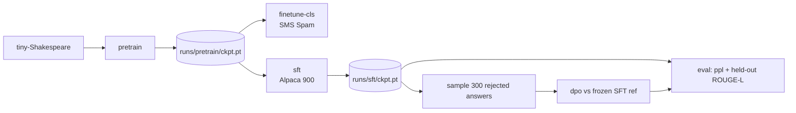

# minigpt — GPT from scratch

A small GPT built step by step in PyTorch: a byte-level BPE tokenizer, the
transformer, pretraining, loading real GPT-2 weights, classifier fine-tuning, SFT
and DPO. Only `torch.nn` primitives are used (Linear, Embedding, LayerNorm). The
tokenizer, attention, training loop, loss masking and DPO loss are all written here.
Curriculum lessons 30–41 of *AI Engineering from Scratch*.

## Problem

Each stage of a modern LM pipeline is shown as a small, testable module:

| Stage | Module | What it shows |
|---|---|---|
| Tokenizer | `bpe.py` | byte-level BPE trainer/encoder/decoder, GPT-2 pre-tokenisation regex, JSON save/load, special tokens |
| Data | `data.py` | sliding-window `(x, y)` next-token dataset |
| Model | `model.py` | token + learned position embeddings, own causal MHA (optional `F.scaled_dot_product_attention`), pre-LN blocks, GELU MLP, weight-tied head, `generate(temperature, top_k)` |
| Training | `train.py` | AdamW (decay on 2-D weights only), linear warmup + cosine LR, clip 1.0, periodic eval, best-val checkpoint, device mps → cuda → cpu |
| Pretrained | `pretrained.py` | HF GPT-2 124M safetensors → `GPTConfig(50257, 1024, 768, 12, 12)`, Conv1D transposes |
| Classifier | `finetune_cls.py` | head swap to 2 classes; train last block + final LN + head on UCI SMS Spam (balanced, 70/10/20) |
| SFT | `sft.py` | Alpaca prompt template, prompt tokens masked with `-100` |
| DPO | `dpo.py` | DPO loss (β = 0.1) against a frozen reference; pairs = dataset answer (chosen) vs SFT sample (rejected) |
| Eval | `evaluate.py` | perplexity, classification metrics, `Judge` protocol with offline ROUGE-L default |

## Architecture





## Quickstart

Run from `packages/minigpt/`. Downloads go to `data/raw/`, outputs to `runs/` (both gitignored).

```bash
uv run minigpt train-tokenizer                     # BPE, vocab 1024, on tiny-Shakespeare
uv run minigpt pretrain --data tinyshakespeare --steps 2000
uv run minigpt generate --prompt "ROMEO:"
uv run minigpt data spam && uv run minigpt finetune-cls
uv run minigpt data alpaca && uv run minigpt sft
uv run minigpt dpo
uv run minigpt eval
```

Tests (from the repo root): `uv run pytest packages/minigpt -q`. The GPT-2 parity test
needs internet and the extras:
`uv run --package minigpt --extra hf --extra test pytest packages/minigpt -m network`.

## Results

All numbers come from one run on an Apple-silicon Mac (`device=mps`), seed 0, with the
CLI defaults. The model is 6 layers, d=256, 8 heads, context 256, 5.07M params, BPE vocab 1024.

| Experiment | Metric | Result |
|---|---|---|
| BPE on tiny-Shakespeare | vocab / compression | 1024 tokens, 2.41 bytes/token (17 s to train) |
| Pretrain, 2000 steps (5 min 42 s) | val loss, step 0 → best | **6.993 → 3.648 (−47.8%)**, best at step 800 |
| Pretrain | val perplexity (best ckpt) | 40.27 |
| SMS Spam, head swap (790,786 trainable params) | test accuracy / F1 (n=300) | **0.940** / 0.939 (precision 0.965, recall 0.914) |
| SFT, Alpaca 900 rows × 3 epochs | train loss | 4.286 → 3.453 |
| DPO, 300 pairs, β=0.1, 2 epochs | loss at step 1 / epoch 2 mean | 0.6931 (= log 2) / 0.2314; reward accuracy 0.95 |
| Held-out Alpaca (50 rows, greedy) | ROUGE-L F1, pretrain / SFT / DPO | 0.064 / 0.095 / 0.076 |
| GPT-2 124M parity (network test) | greedy 10 tokens vs HF `transformers` | identical (test passes) |
| Unit tests | `pytest packages/minigpt` | 19 passed, 1 deselected (network) in 2.5 s |

Pretrain log (excerpt):

```text
device=mps train_tokens=414,007 val_tokens=46,001
params=5,066,752
step     0 train 6.9923 val 6.9396 lr 1.00e-05
step   400 train 3.5398 val 3.8656 lr 9.46e-04
step   800 train 2.9612 val 3.6481 lr 7.31e-04
step  1200 train 2.3985 val 3.7635 lr 4.40e-04
step  1999 train 1.8530 val 4.1113 lr 1.00e-04
val loss step0=6.9929 best=3.6481 drop=47.8%
```

`minigpt generate --prompt "ROMEO:"`:

```text
ROMEO:
It's name, my wilt bend?

ROMEO:
Ay, the dead; and I would thou wilt swear,
I fear thy sound not that thou shouldst wilt say it thee.

ROMEO:
Then, sin me, thou art a man that thou art a torment,
To have thee in thee to death; let
```

SFT sample on a held-out instruction (greedy):

```text
### Instruction: Calculate the cost of 4 apples at $2.50 each.
### Model: The calcon is 1000.
### Reference: The cost of 4 apples at $2.50 each is $10.00.
```

How to read these results:
- **Overfitting.** About 414k training tokens is small for 5M params. Val loss bottoms out at step 800 and rises after that while train loss keeps falling. The checkpoint keeps the best-val weights, so every downstream stage starts from step 800.
- **SFT.** The model learns the response *format*: short declarative answers that reuse words from the instruction. It cannot learn facts or arithmetic, because it was pretrained only on Shakespeare.
- **DPO.** It learns the preference: reward accuracy reaches 0.95 and the loss falls from exactly log 2. But held-out ROUGE-L drops from SFT's 0.095 to 0.076. The rejected samples come from the same weak model, so DPO mostly learns to move away from its own outputs. This matches the known DPO failure mode: it optimises likelihood margins, not answer quality. The number is reported as measured.

## Design decisions

- **Byte-level BPE with GPT-2 regex pre-tokenisation.** Byte-level means no unknown tokens and lossless round-trips (tested on CJK and emoji). The regex stops merges from crossing word and punctuation boundaries. When two pairs have the same count, the smallest pair id wins, so training is deterministic. Encoding memoises each chunk, so encoding the 1.1 MB corpus takes seconds.
- **Own attention with an SDPA flag.** The explicit masked-softmax path is the reference implementation, and a test checks that it matches `F.scaled_dot_product_attention`. MPS's fused kernel has no dropout support, so in training on MPS the model falls back to the explicit path.
- **Weight tying.** The 124M config has exactly 124,439,808 parameters (tested on the `meta` device, so no memory is allocated). This matches GPT-2.
- **Checkpoints store `asdict(config)`, not a pickled dataclass.** This keeps them loadable with `torch.load`'s default `weights_only=True`.
- **The classifier reads the last *non-pad* token.** Causal attention means that position has seen the whole message and none of the padding. A test checks that extra padding does not change the logits.
- **DPO runs the policy with dropout off** (`eval()` mode, gradients still flow). Without this, dropout noise alone makes policy ≠ reference at step 0, and the first loss came out at 0.94 instead of log 2 in an earlier run.
- **No offline fake data.** Downloads raise an error on failure; they never fall back to fabricated samples. Default tests are fully offline. The HF parity test is marked `network` and `slow`.
- **CPU torch on Linux CI.** `[tool.uv.sources]` sends `torch` to the PyTorch CPU index on Linux only; macOS keeps the PyPI wheel, which includes MPS.
