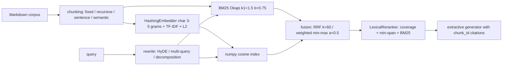

# ragkit

Retrieval-augmented generation built from first principles and benchmarked on a self-written energy-flexibility corpus (25 docs on demand response, battery dispatch, imbalance settlement, day-ahead markets, heat pumps, EV smart charging, …; 40 labelled questions).

## Problem
Which retrieval stack actually finds the right document? ragkit implements every stage with no retrieval libraries (BM25, hashing embeddings, fusion, reranking, rewriting, metrics) so each stage can be measured in isolation, offline and deterministically.

## Architecture

Optional extras: `[st]` swaps in `all-MiniLM-L6-v2` embeddings and the `ms-marco-MiniLM-L-6-v2` cross-encoder; `[llm]` adds `AnthropicLLM` (needs `ANTHROPIC_API_KEY`) for rewriting.

## Quickstart
```bash
uv sync --all-packages
uv run ragkit index packages/ragkit/src/ragkit/data/corpus     # writes .ragkit/index.json
uv run ragkit ask "What is imbalance settlement?" --index .ragkit/index.json
uv run ragkit ask "What is imbalance settlement?"              # indexes the bundled corpus on the fly
uv run ragkit eval --strategies all                             # or a subset: bm25,dense,hybrid,rerank
```

## Results
`ragkit eval --strategies all` (recursive chunks of 500 chars, 50 overlap, offline defaults):

| Strategy        | Rewrite | Recall@5 | MRR    | nDCG@10 |
|-----------------|---------|----------|--------|---------|
| BM25            | None    | 1.0000   | 0.9396 | 0.9548  |
| BM25            | HyDE    | 0.9750   | 0.9354 | 0.9512  |
| Dense           | None    | 0.9750   | 0.9182 | 0.9381  |
| Dense           | HyDE    | 0.7000   | 0.5130 | 0.5811  |
| Hybrid (RRF)    | None    | 1.0000   | 0.9437 | 0.9581  |
| Hybrid (RRF)    | HyDE    | 0.9250   | 0.7575 | 0.8167  |
| Hybrid + Rerank | None    | 0.9750   | 0.9417 | 0.9562  |
| Hybrid + Rerank | HyDE    | 0.8000   | 0.4993 | 0.6030  |

Findings, reported as-is (no tuning on the eval set):
- Hybrid RRF gives the best MRR/nDCG. Hybrid+rerank recall@5 (0.975) is **below** BM25 (1.000): the lexical reranker pushes one relevant doc out of the top 5. The corpus is small and keyword-heavy, so BM25 is close to saturated.
- Template HyDE hurts every retriever. The offline `TemplateLLM` writes generic energy-market text, which pulls queries towards the same few docs. HyDE needs a real LLM (`[llm]`) to help.

`ragkit ask "What is imbalance settlement?" --index .ragkit/index.json`, verbatim:
```
Question: What is imbalance settlement?

Answer:
## Balancing Energy Gate Closure and Cross-Border MARI/PICASSO Platforms

The implementation of 15-minute imbalance settlement periods across Europe is coordinated with centralized balancing energy exchange platforms: PICASSO for automatic Frequency Restoration Reserves (aFRR) and MARI for manual Frequency Restoration Reserves (mFRR). [doc_24_subhourly_dispatch#rec_5] # Imbalance Settlement Principles and Dual-Pricing Mechanisms

Imbalance settlement is the post-delivery commercial accounting framework that financially penalizes deviations between a Balance Responsible Party's (BRP) contracted market position and its actual metered energy flows. [doc_05_imbalance_settlement#rec_0] A BRP's imbalance volume in settlement period t is defined as:
Imbalance_Volume(t) = Metered_Generation(t) - Metered_Consumption(t) + Contracted_Sales(t) - Contracted_Purchases(t). [doc_05_imbalance_settlement#rec_1]

Citations: doc_24_subhourly_dispatch#rec_5, doc_05_imbalance_settlement#rec_0, doc_05_imbalance_settlement#rec_1
```
Known limitation visible above: the extractive generator splits on sentence punctuation, not on markdown structure, so section headings leak into the answer text and the top-ranked sentence comes from a neighbouring doc that mentions the term.

## Design decisions
- **Protocols for every model boundary** (`Embedder`, `Reranker`, `LLM`, `Generator`): offline defaults keep tests deterministic, and neural models plug in through extras.
- **Hashing embedder instead of a vocabulary**: fixed 512-dim, no fitting state beyond IDF, handles unseen words and typos through char n-grams.
- **RRF as the default fusion**: it is rank-based, so BM25 and cosine scores never need calibration against each other.
- **Extractive generator**: every sentence keeps its `[chunk_id]`, so faithfulness is checkable by construction.
- **Doc-level metrics**: chunks are deduplicated to doc ids before computing recall/MRR/nDCG, matching how `qa.jsonl` is labelled.
- **Persisted index = chunks only**: `ragkit index` writes the chunk list to JSON. BM25 statistics and hashing embeddings are rebuilt from it at load time (milliseconds at this scale), which keeps the format trivial and versionable.